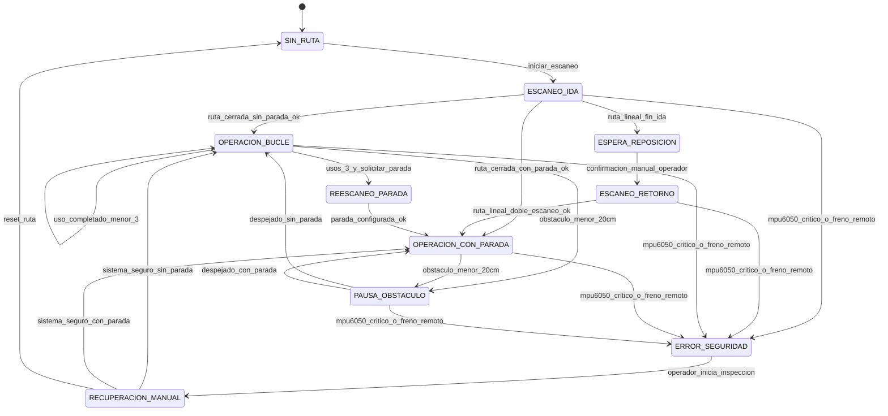
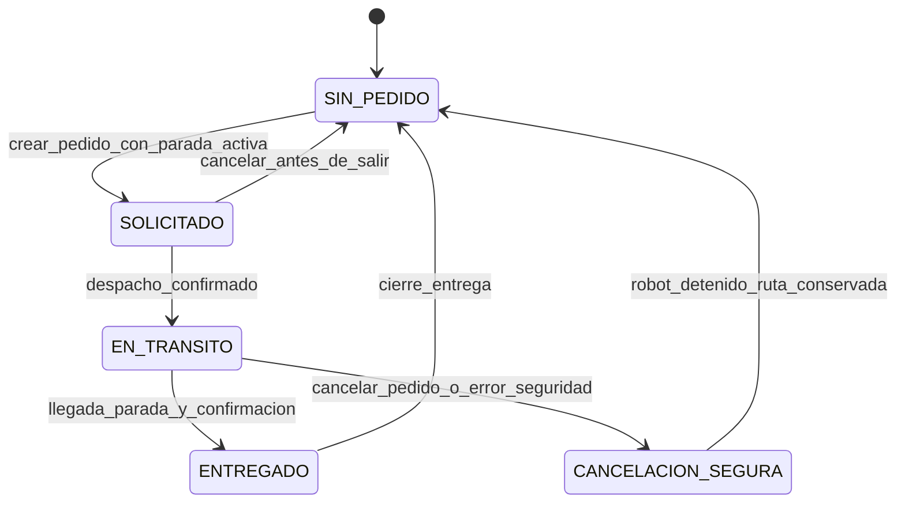

# Especificación Canónica de Máquinas de Estado (`TG Robot UCAB`)

**Versión:** `2.0.0` (alineada con `specs/mqtt/contract.json` v2.0.0 y `specs/pista_canonica.json` v1.0.0)  
**Fuente de verdad ejecutable (Capa 3):** `prototipos/P05-gemelo-digital/capa3_operacional.js`  
**Estado:** Canónica · Alineada 1:1 con `contract.json` v2.0.0 y las tres capas del AGV  
**Terminología oficial:** *teach-and-repeat* y aprendizaje progresivo (nunca "IA").

---

## 1. Arquitectura por Capas (Inventario Exacto)

El comportamiento del AGV se separa en **tres capas desacopladas** para evitar duplicar lógica entre el núcleo portable (`C++` / `JS`), el Gemelo Digital (`P05`) y la capa de operación/app (`P09`):

| Capa | Fuente de verdad | Cantidad de estados | Responsabilidad |
|---|---|---:|---|
| **Capa 1 — Navegación** | `specs/navegacion/teach_and_repeat.js` | **5** | Control determinista de seguimiento de línea, `HEADING_HOLD`, reenganche y validación de balizas BLE. |
| **Capa 2 — Aprendizaje / Gemelo** | `prototipos/P05-gemelo-digital/aprendizaje_gemelo.js` (`L14–L29`) | **14** | Calibración de pista, congelamiento de geometría de referencia, viajes de ajuste RMS y prueba sin cinta. |
| **Capa 3 — Operacional (Nueva)** | `prototipos/P05-gemelo-digital/capa3_operacional.js` + `specs/state-machine.md` | **10 + 5** (2 máquinas ortogonales) | Ciclo de vida operativo de **Rutas** (10 estados: Cerrada vs. Lineal, seguridad MPU-6050) y **Pedidos** (5 estados: despacho y cancelación segura). |

---

## 2. Capa 1 — Navegación (`teach_and_repeat.js`)

Máquina de estados determinista y pura (`paso(nav, entradas)`), portable 1:1 a C++ (ESP32), sin reloj ni estado oculto.

### 2.1 Estados exactos (5)

| Código | Estado | Función |
|---:|---|---|
| `0` | `FOLLOW_LINE` | Sigue la cinta de `19 mm` con corrección PD sobre los 4× TCRT5000 (`[27, 9, -9, -27] mm`, `KP_LINEA = 0,030`, `BASE_VEL = 0,80`). |
| `1` | `LINE_LOST_CHECK` | Buffer de pérdida de línea (`TIEMPO_LINEA_PERDIDA_MS = 500 ms`) antes de declarar tramo sin cinta o pérdida real. |
| `2` | `HEADING_HOLD` | Mantiene rumbo relativo mediante giroscopio MPU-6050 (`K_HEADING = 0,02`) en un tramo sin cinta previamente enseñado. |
| `3` | `WAIT_BEACON` | Aproximación lenta (`VEL_APROX_BEACON = 0,20`) al detectar baliza BLE de destino (`RSSI >= -80 dBm`) hasta validar llegada (`RSSI >= -52 dBm`). |
| `4` | `REACQUIRE_LINE` | Búsqueda controlada (`VEL_BUSQUEDA = 0,30`) para reenganchar la cinta al terminar un tramo sin línea. |

### 2.2 Umbrales y reglas de seguridad (Capa 1)
- **Ultrasonido frontal (`HC-SR04P`):** `< 20 cm` (`teach_and_repeat.js:L35`, `pista_canonica.json:L49`) → frenado crítico inmediato (`v = 0`, estado lógico intacto; reanuda al despejar); `20–50 cm` (`teach_and_repeat.js:L36`, `pista_canonica.json:L50`) → precaución (velocidad a la mitad).
- **Balizas BLE (solo extremos, sin emparejamiento GATT):** detección `RSSI >= -80 dBm` (`specs/navegacion/teach_and_repeat.js:L46`, `specs/pista_canonica.json:L51`) y llegada `RSSI >= -52 dBm` (`specs/navegacion/teach_and_repeat.js:L47`, `specs/pista_canonica.json:L52`, clave `"rssiLlegadaDbm"`). Solo valida llegada después de haber salido del inicio (`haSalidoDeInicio = true`).
- **Transición directa `HEADING_HOLD → WAIT_BEACON`:** si el hueco sin cinta termina en el extremo y se detecta `RSSI >= -80 dBm` (tras salir del inicio), salta directamente a `WAIT_BEACON` sin pasar por `REACQUIRE_LINE`.
- **Latches terminales de seguridad (`paradaSeguridad = true`, sin reanudación automática):**
  - Timeout sin línea: `TIEMPO_MAX_SIN_LINEA_MS = 4000 ms` (inmutable; huecos `> ~4,5 m` a velocidad base terminan en `timeout_sin_linea`).
  - Deriva excesiva del giroscopio en `HEADING_HOLD`: `|error_rumbo| > 30°` (`DRIFT_MAX_GRADOS = 30`). Tiene prioridad sobre la detección de baliza.

---

## 3. Capa 2 — Aprendizaje / Gemelo Digital (`aprendizaje_gemelo.js`)

Definida exactamente en `prototipos/P05-gemelo-digital/aprendizaje_gemelo.js` (`L14–L29`).

**Regla de ingeniería inmutable:** la geometría capturada durante `SLOW_READING` (`0,16 m/s`) se congela (`Object.freeze`) como `geometriaRef`. Los viajes posteriores en `ADJUSTING` **solo** refinan el modelo dinámico (`wheel_tau_s` hacia `0,18 s`).

### 3.1 Estados exactos (14)

| # | Estado | Rol y transición principal |
|---:|---|---|
| 1 | `INITIAL` | Estado inicial sin geometría congelada. `iniciarViaje('SLOW_READING')` → `SLOW_READING`. |
| 2 | `SLOW_READING` | Primera pasada lenta (`0,16 m/s`). Al completar válida (cobertura `>= 95 %`) congela `geometriaRef` → `NORMAL_READING`. |
| 3 | `NORMAL_READING` | Segunda pasada a velocidad nominal (`0,41 m/s`). Fija `PC1–PC3` equitativos (`L/3`, `2L/3`, `L`) y `rmsBaseMm` → `TWIN_CREATING`. |
| 4 | `TWIN_CREATING` | Consolidación automática del Gemelo V1 (`TRANSICION_GEMELO_MS = 600 ms`) → `TWIN_V1_READY`. |
| 5 | `TWIN_V1_READY` | Gemelo V1 listo para viajes de ajuste dinámico. Al iniciar ajuste → `ADJUSTING`. |
| 6 | `ADJUSTING` | Ejecuta viajes de ajuste válidos (`META_VIAJES_DEMO = 3` o `META_VIAJES_SIL = 5`). Al alcanzar la meta → `EVALUATION_PENDING`. |
| 7 | `EVALUATION_PENDING` | Meta de viajes alcanzada; espera ejecución de `evaluarGemelo(ap)` → `PHASE1_READY` o `ADJUSTMENT_REQUIRED`. |
| 8 | `ADJUSTMENT_REQUIRED` | Evaluación rechazada por calidad insuficiente (RMS o cobertura). Requiere nuevos viajes en `ADJUSTING`. |
| 9 | `PHASE1_READY` | Gemelo validado por calidad. Permite práctica con obstáculos (`OBSTACLE_PRACTICE`, no altera validación) o `activarFase1()` → `BEACONS_STARTING`. |
| 10 | `BEACONS_STARTING` | Arranque de balizas BLE (`B1`/`B2`, `TRANSICION_BALIZAS_MS = 650 ms`) → `BEACONS_ACTIVE`. |
| 11 | `BEACONS_ACTIVE` | Balizas activas (estados visuales: `apagada`, `encendiendo`, `anunciando`, `detectada`, `rssi_valido`). En Pista B habilita `NO_TAPE_TEST`. |
| 12 | `NO_TAPE_TEST` | Prueba sin cinta en tramo recto `T2` (bloqueada en Pista A por geometría curva). Al completar sin fallos → `PHASE1_VALIDATED`. |
| 13 | `PHASE1_VALIDATED` | Fase 1 validada completamente (navegación + balizas + cruce sin cinta). Permite repetir pruebas sin cinta. |
| 14 | `FAULT` | Freno Remoto, parada de seguridad o cobertura `< 95 %` durante un viaje activo (el viaje inválido nunca cuenta). `recuperarFallo()` retorna al estado previo seguro (`BEACONS_ACTIVE`, `INITIAL`, `NORMAL_READING`, `TWIN_V1_READY`, `ADJUSTING` o `EVALUATION_PENDING`). |

### 3.2 Criterios de evaluación por calidad (`evaluarGemelo`)
La aprobación depende de **calidad real**, nunca solo del contador de viajes:
- Error lateral RMS medio: `lateral_error_rms_mm <= 18,0 mm`
- Error angular RMS medio: `heading_error_rms_deg <= 4,5°`
- Cobertura media de pista: `coverage_pct >= 95,0 %`

---

## 4. Capa 3 — Operacional (Dos Máquinas Ortogonales)

La operación diaria de la app y del robot se modela con **dos máquinas ortogonales** (evolucionan en paralelo, acopladas solo por guardas explícitas):
1. **Máquina de Rutas:** gobierna el tipo de pista, el ciclo de escaneo/operación y la seguridad física.
2. **Máquina de Pedidos:** gobierna el ciclo de vida de una solicitud de transporte cuando la ruta tiene parada configurada.

### 4.1 Reglas diferenciadas por tipo de ruta

| Aspecto | Ruta Cerrada (`circuito_cerrado`) | Ruta Lineal (`lineal`) |
|---|---|---|
| **Parada de entrega** | **Opcional.** Sin parada opera en bucle continuo (con o sin carga) y **no acepta pedidos**. | **Obligatoria** desde el primer escaneo. |
| **Habilitación de parada** | Tras completar **`N = 3` usos completados** en operación normal, habilita **reescaneo** para configurar una parada. | Configurada obligatoriamente durante el doble escaneo inicial. |
| **Escaneo inicial** | Pasada en lazo cerrado hasta regresar al inicio. | **Doble escaneo obligatorio (ida + retorno)** con parada intermedia en `ESPERA_REPOSICION`. |
| **Confirmación de retorno** | No aplica (lazo cerrado). | `ESPERA_REPOSICION` exige **confirmación manual explícita** del operador; **nunca hay auto-retorno por timeout**. |

### 4.2 Máquina de Rutas (Capa 3A)

**Definición de estados críticos y reglas (`capa3_operacional.js` · 10 estados de `ESTADOS_RUTA`):**
1. `SIN_RUTA`, 2. `ESCANEO_IDA`, 3. `ESPERA_REPOSICION`, 4. `ESCANEO_RETORNO`, 5. `OPERACION_BUCLE`, 6. `REESCANEO_PARADA`, 7. `OPERACION_CON_PARADA`, 8. `PAUSA_OBSTACULO`, 9. `ERROR_SEGURIDAD`, 10. `RECUPERACION_MANUAL`.
- `ESPERA_REPOSICION`: robot detenido al final del tramo de ida en ruta lineal; espera reposicionamiento físico y confirmación manual del operador. **Prohibido el auto-retorno por temporizador.**
- `PAUSA_OBSTACULO`: frenado controlado por obstáculo frontal `< 20 cm`; mantiene el estado de ruta y pedido, y reanuda al despejar.
- `ERROR_SEGURIDAD`: disparado con prioridad absoluta por el **MPU-6050** (impacto brusco, inclinación excesiva o atascamiento/bloqueo prolongado de ruedas) o por **Freno Remoto**. Corta motores de inmediato y bloquea órdenes de movimiento.
- `RECUPERACION_MANUAL`: estado controlado donde el operador/administrador verifica físicamente el robot; **mantiene bloqueadas todas las órdenes de movimiento** (`puedeMover() === false`) hasta confirmar `completarRecuperacionManual()`.
- **Cambio de tipo de ruta (`setTipoRuta()`):** cambiar entre `cerrada` y `lineal` reinicia limpiamente a `SIN_RUTA`, `SIN_PEDIDO`, `usosCompletados = 0`, `rutaAprendida = null`, alertas y relojes en `0`.

### 4.3 Máquina de Pedidos (Capa 3B)

Ortogonal a la Máquina de Rutas. Solo puede salir de `SIN_PEDIDO` cuando la Máquina de Rutas está en `OPERACION_CON_PARADA` (nunca en `OPERACION_BUCLE` sin parada).

**Reglas clave de `CANCELACION_SEGURA`:**
- Ejecuta frenado controlado (`0,55 m/s²` en rampa suave o parada inmediata si hubo `ERROR_SEGURIDAD`).
- **Nunca borra la ruta aprendida** (`geometriaRef`, `puntosControl` y perfil calibrado permanecen intactos).
- Al confirmar velocidad `0 m/s`, retorna a `SIN_PEDIDO`.

---

## 5. Invariantes de Seguridad y Cinemática Canónica

### 5.1 Invariantes de seguridad (no negociables)
1. **Bloqueo de movimiento en la App:** la aplicación **no puede** enviar ni habilitar órdenes de movimiento (`adelante`, `atras`, `izquierda`, `derecha`, `auto`) mientras la Máquina de Rutas esté en `ESPERA_REPOSICION`, `ERROR_SEGURIDAD` o `RECUPERACION_MANUAL` (`puedeMover(op) === false`).
2. **Prioridad del MPU-6050:** los eventos de seguridad del MPU-6050 (impacto, inclinación anormal, atascamiento) tienen prioridad absoluta sobre cualquier lazo de movimiento o despacho de pedido y fuerzan transición inmediata a `ERROR_SEGURIDAD`.
3. **Sin magnetómetro (rumbo relativo):** el MPU-6050 se usa exclusivamente como giroscopio de rumbo **relativo** y detector de anomalías dinámicas; **nunca** como yaw absoluto o brújula.
4. **Sin auto-retorno por timeout en ruta lineal:** `ESPERA_REPOSICION` solo avanza con confirmación manual explícita.
5. **Integridad de ruta ante cancelación:** `CANCELACION_SEGURA` detiene el pedido y el movimiento sin eliminar la ruta aprendida.

### 5.2 Constantes cinemáticas oficiales (`P04` / `P05` / `specs/pista_canonica.json`)

| Parámetro | Valor canónico | Referencia |
|---|---|---|
| Velocidad lenta de escaneo (`VEL_LENTA_MS`) | **`0,16 m/s`** | `aprendizaje_gemelo.js` (`L32`) |
| Velocidad nominal de operación (`VEL_NORMAL_MS`) | **`0,41 m/s`** | `aprendizaje_gemelo.js` (`L33`) / media `P04` |
| Velocidad máxima teórica (`PWM 1,0`, `11,1 V`, L298N `2,1 V`) | **`0,572 m/s`** (`0,457 m/s` a `PWM 0,8` en recta) | `P04/codigo/model.js` (`L5–L34`) |
| Retardo de 1.er orden de ruedas (`P04`) | **`tau = 0,18 s`** (suavizado manual `0,08 s`) | `P04/codigo/model.js` (`L15`), `sim.js` (`L11`) |
| Limitador de rampa (`P05`) | Aceleración **`0,90 m/s²`** · Frenado **`0,55 m/s²`** | `P05/simulador_movimiento.js` (`L54–L55`) |
| Duración nominal en pista canónica (`9,00 m` a `0,41 m/s`) | **`21,95 s`** por pasada · Lineal ida+retorno: **`43,90 s` + pausa manual** (`ESPERA_REPOSICION`) | Derivado de `9,00 / 0,41` |
| Selector de velocidad de simulación | **`1x` / `2x` / `4x`** aplicado **solo al reloj de simulación** (nunca altera física ni velocidades reales del robot) | Convención SIL |

### 5.3 Convención de Puntos de Control (Funcionales vs. Equitativos)

Ambas convenciones conviven explícitamente en `specs/pista_canonica.json` (`L31–L46`) sin contradicción:

| Convención | Distancias en Pista B (`9,00 m`) | Distancias en Pista A (`8,05 m`) | Uso |
|---|---|---|---|
| **PCs Funcionales (Navegación · Capa 1)** | **`3,0 / 4,5 / 7,5 m`** | N/A (sin tramo recto `T2` sin cinta) | Rigen el núcleo `teach_and_repeat.js`: `PC1` inicio de `HEADING_HOLD` (`T2`), `PC2` reenganche (`REACQUIRE_LINE`), `PC3` detección de baliza `B2` (`WAIT_BEACON`). |
| **PCs Equitativos (Calibración / UI · Capas 2 y 3)** | **`3,0 / 6,0 / 9,0 m`** (`L/3`, `2L/3`, `L`) | **`2,68 / 5,37 / 8,05 m`** (`L/3`, `2L/3`, `L`) | Dividen cualquier pista en 3 segmentos homogéneos para calibración en `P05`, mini-mapa `P04` (`PC3 / META`) y mapa lineal/cerrado de la App Flutter (`P09`). |
