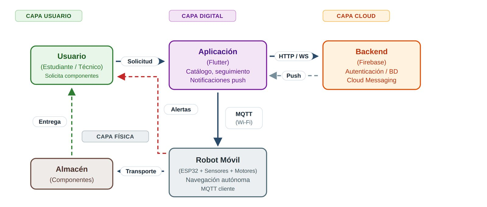
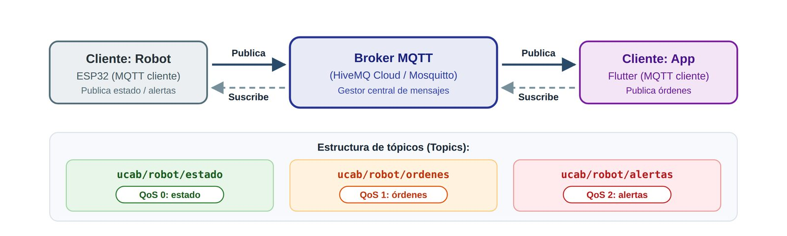
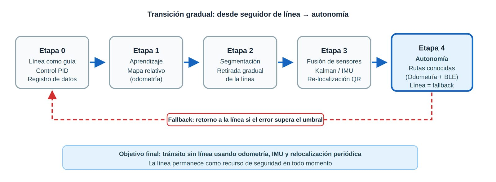
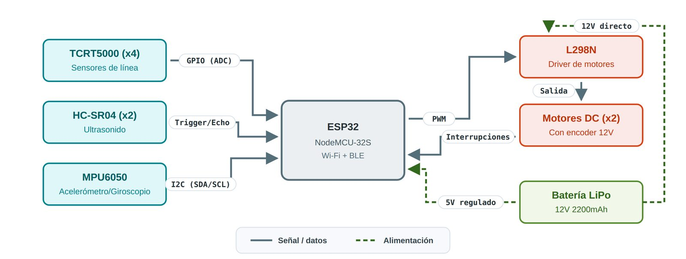
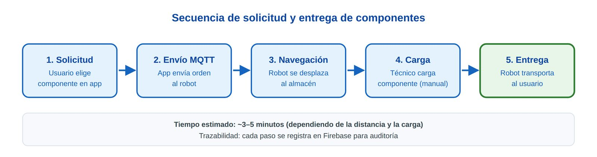
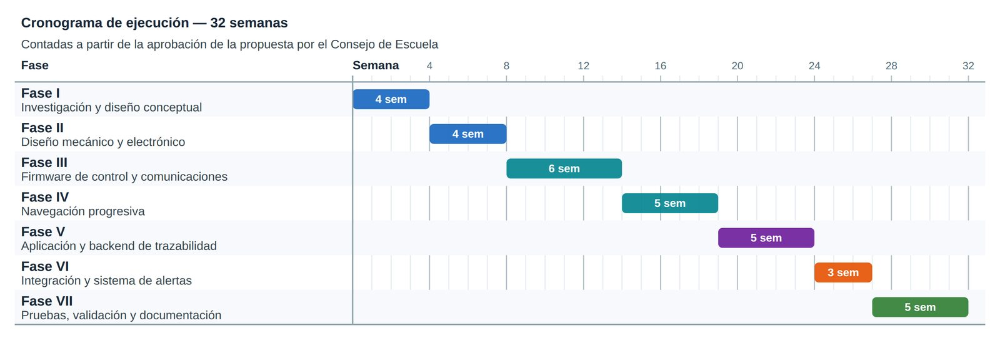

> Versión web de la **Propuesta de Trabajo de Grado** entregada en agosto de 2026 (Seminario de Grado). Por privacidad, esta versión pública **omite cédulas de identidad, teléfonos y correos electrónicos** de los responsables; el PDF enlazado en la cabecera es la copia pública con esos datos ocultos. La numeración de páginas del original se omitió.

**UNIVERSIDAD CATÓLICA ANDRÉS BELLO**

Facultad de Ingeniería

Escuela de Ingeniería en Telecomunicaciones

# Robot móvil para búsqueda y transporte de componentes en el laboratorio de la UCAB con aplicación de solicitudes y alertas

**PROPUESTA DE TRABAJO DE GRADO**

Presentada ante la UNIVERSIDAD CATÓLICA ANDRÉS BELLO como requisito para optar al título de INGENIERO EN TELECOMUNICACIONES

**REALIZADO POR:**

Semprun Cascitelli, Iliana Vanessa

Ferrer Pinto, Andrea Valentina

**TUTOR:**

Ing. Cante Mata, Biagio Domenico

Caracas, agosto de 2026

---

## a) Título

Robot móvil para búsqueda y transporte de componentes en el laboratorio de la UCAB con aplicación de solicitudes y alertas.

## b) Datos de los Responsables del Trabajo

| Rol | Nombres y Apellidos | Afiliación |
|---|---|---|
| Tutor | Ing. Biagio Domenico Cante Mata | Universidad Católica Andrés Bello (UCAB) |
| Tesista 1 | Iliana Vanessa Semprun Cascitelli | Estudiante · Escuela de Ingeniería en Telecomunicaciones, UCAB |
| Tesista 2 | Andrea Valentina Ferrer Pinto | Estudiante · Escuela de Ingeniería en Telecomunicaciones, UCAB |

*Cédulas de identidad, teléfonos y correos electrónicos omitidos en la versión pública.*

## c) Planteamiento del Problema

En los laboratorios de la Escuela de Ingeniería en Telecomunicaciones de la UCAB, la gestión y entrega de componentes electrónicos sigue siendo un proceso manual y centralizado. El almacén de componentes está ubicado en un punto fijo de la planta baja, lo que obliga a estudiantes y técnicos a desplazarse repetidamente para solicitar resistencias, sensores, microcontroladores y otros materiales. Este flujo genera interrupciones, pérdidas de tiempo y reduce las horas efectivas de trabajo en los proyectos académicos.

Además de la ineficiencia temporal, el proceso actual dificulta el control de inventario y la trazabilidad de las entregas. No existe un registro automatizado que permita conocer qué componentes se han retirado, por quién y en qué momento. En un entorno donde la optimización del tiempo y la organización son críticas, estas limitaciones constituyen una oportunidad clara para introducir una solución tecnológica que mejore la logística interna del laboratorio.

El problema central que aborda este Trabajo de Grado es, por tanto, la ausencia de un sistema automatizado de transporte interno y de trazabilidad de componentes en el laboratorio. La solución propuesta consiste en un robot móvil autónomo de bajo costo que transporte los componentes desde el almacén hasta los puntos de trabajo, integrado con una aplicación de solicitudes y con un sistema de comunicación inalámbrica que permita registrar las entregas, monitorear el estado del robot en tiempo real y emitir alertas de seguridad ante manipulaciones no autorizadas. La dimensión de telecomunicaciones del proyecto reside en la arquitectura de comunicación inalámbrica entre el robot, la aplicación y el servidor: protocolos de mensajería IoT, redes inalámbricas locales, posicionamiento por radiofrecuencia y notificaciones, que son el eje que articula el funcionamiento del sistema.

La arquitectura general de la solución se resume en la Figura 1, donde se distinguen cuatro capas (usuario, digital, nube y física) y los flujos de información que las vinculan. El usuario interactúa con la aplicación para solicitar componentes; el robot recibe la orden a través del broker de mensajería, transporta el material desde el almacén y devuelve al sistema notificaciones de estado y alertas de seguridad.

*Figura 1. Arquitectura general del sistema propuesto.*

La importancia de resolver este problema es doble. Por un lado, mejora directamente la productividad y la trazabilidad dentro del laboratorio. Por otro, genera un prototipo replicable y de bajo costo cuya arquitectura de comunicaciones y logística interna puede adaptarse a otros entornos (almacenes educativos, talleres, oficinas), lo que amplía el impacto potencial de la solución.

## d) Objetivos

### Objetivo General

Desarrollar un prototipo funcional de robot móvil autónomo de bajo costo, integrado con una aplicación de solicitudes y un sistema de comunicación IoT, para el transporte y la trazabilidad de componentes electrónicos en el laboratorio de la Escuela de Ingeniería en Telecomunicaciones de la UCAB, incorporando un mecanismo de alertas de seguridad ante manipulación no autorizada.

### Objetivos Específicos

1. Diseñar la arquitectura de comunicación inalámbrica del sistema (robot–aplicación–servidor) basada en el protocolo MQTT y servicios en la nube, definiendo los tópicos, la calidad de servicio (QoS) y los flujos de mensajes para órdenes, estado y alertas.
2. Realizar un estudio comparativo y seleccionar los componentes de hardware (microcontrolador, controlador de motores, sensores, batería) bajo criterios de costo, consumo energético, disponibilidad y compatibilidad.
3. Diseñar y construir la plataforma mecánica del robot, con chasis impreso en 3D y configuración de tracción diferencial, acorde con las dimensiones, cargas y rutas del entorno del laboratorio.
4. Desarrollar el firmware de control del robot, implementando el seguimiento de línea mediante control PID, la adquisición de sensores (línea, ultrasónicos e inercial) y la comunicación MQTT con el servidor.
5. Implementar un esquema de navegación progresivo que combine el seguimiento de línea con odometría y fusión de sensores inerciales, incorporando puntos de re-localización absoluta para acotar la deriva acumulada en rutas previamente mapeadas.
6. Desarrollar la aplicación móvil/web de solicitudes y el backend de trazabilidad, incluyendo catálogo de componentes, seguimiento del robot en tiempo real, historial de entregas y notificaciones.
7. Implementar el módulo de alertas de seguridad anti-manipulación basado en el acelerómetro, definiendo los umbrales de detección y evaluando la tasa de detección y la tasa de falsas alarmas.
8. Evaluar el desempeño integral del sistema mediante pruebas en una maqueta del laboratorio, midiendo la precisión de navegación, la latencia y fiabilidad de la comunicación, la autonomía energética y la eficacia de las alertas.
9. Documentar las limitaciones técnicas del sistema y proponer mejoras futuras orientadas a su escalabilidad y a su adaptación a otros entornos de aplicación.

## e) Marco Referencial

Esta sección integra los enfoques teóricos y antecedentes técnicos que sustentan el diseño del sistema, identificando las fuentes consultadas. Constituye una primera versión del marco teórico del Trabajo de Grado.

### 1. Robótica móvil y tracción diferencial

La robótica móvil estudia los mecanismos que permiten a un robot desplazarse en un entorno real para cumplir tareas de locomoción, percepción, localización y planificación de movimiento [1]. Para entornos interiores de espacio reducido, la configuración de tracción diferencial (dos ruedas motorizadas independientes y una o dos ruedas locas de apoyo) es ampliamente utilizada porque permite giros sobre el propio eje y un control sencillo de la trayectoria a partir de la velocidad relativa de las ruedas [1]. El prototipo propuesto adopta esta configuración, con un chasis liviano fabricado por impresión 3D en PLA. Esta estrategia de fabricación está validada en plataformas robóticas académicas de código abierto, donde la impresión 3D permite reducir costos, facilitar la reparación de piezas y hacer replicable el diseño en otras instituciones [10], lo que resulta adecuado para las cargas y rutas del laboratorio.

### 2. Seguimiento de línea y control PID

El seguimiento de línea es un método robusto y de bajo costo para guiar un robot por rutas fijas. Se basa en sensores ópticos reflectivos que distinguen entre la superficie y una cinta de contraste; el TCRT5000 de Vishay integra un emisor infrarrojo (950 nm) y un fototransistor con filtro de luz diurna, con un rango útil de operación de 0,2 mm a 15 mm, lo que lo hace idóneo para esta aplicación [6]. La corrección de trayectoria se realiza mediante un controlador proporcional-integral-derivativo (PID), una técnica de control por realimentación de uso extendido en ingeniería [2].

### 3. Odometría, fusión de sensores y localización

La odometría estima el desplazamiento del robot a partir de los pulsos de los encoders acoplados a las ruedas; sin embargo, acumula error por deslizamiento y por imprecisiones del modelo cinemático, por lo que requiere correcciones periódicas [1]. Para mejorar la estimación de orientación y desplazamiento se emplea una unidad de medición inercial (IMU): el MPU6050 de TDK InvenSense integra acelerómetro y giróscopo de tres ejes con salida digital por I²C [5]. La combinación de encoders e IMU mediante técnicas de fusión de sensores (filtro complementario o filtro de Kalman) reduce la incertidumbre de la pose estimada, un enfoque estándar en la localización de robots móviles [1]. Revisiones recientes del área clasifican las arquitecturas de fusión en niveles bajo, medio y alto, y confirman que el filtro de Kalman y sus variantes siguen siendo la solución de referencia para la navegación de robots móviles con recursos de cómputo limitados [11].

### 4. Re-localización absoluta: BLE/RSSI y marcadores visuales

La estimación puramente relativa (odometría e inercial) acumula deriva con el tiempo, por lo que se incorporan puntos de re-localización absoluta en nodos clave de la ruta. Una alternativa de bajo costo es el posicionamiento por radiofrecuencia basado en la intensidad de señal recibida (RSSI) de balizas Bluetooth de baja energía (BLE), técnica estudiada como sistema de posicionamiento en interiores donde el GPS no es viable [7], [8]. Como alternativa visual, pueden emplearse marcadores (códigos QR) en el suelo para corregir la posición en puntos específicos. La dimensión de telecomunicaciones de esta función es central, pues se apoya en la propagación y medición de señales inalámbricas.

### 5. Detección de obstáculos y seguridad física

Para la navegación segura, el robot incorpora medición de distancia por ultrasonido, un principio de telemetría basado en el tiempo de vuelo de un pulso acústico, comúnmente utilizado en robots móviles para evitar colisiones [1]. La seguridad física frente a manipulación no autorizada se aborda con el acelerómetro del MPU-6050: cuando se detecta una aceleración anómala mientras el robot no se encuentra en misión, el sistema genera una alerta con la última ubicación conocida y la transmite a los usuarios [5].

### 6. Control embebido y comunicaciones IoT

El controlador central es un módulo basado en ESP32, un sistema en chip de bajo consumo con doble núcleo y conectividad Wi-Fi y Bluetooth/BLE integrada, ampliamente documentado para aplicaciones de IoT [3]. La conectividad integrada permite que el robot actúe como nodo de una red inalámbrica local. El intercambio de mensajes entre el robot, la aplicación y el servidor se realiza mediante MQTT, un protocolo de mensajería ligero de publicación/suscripción, estandarizado por OASIS y orientado a escenarios de IoT y M2M con recursos limitados [4].

La arquitectura de mensajería prevista se muestra en la Figura 2. El robot (cliente MQTT sobre ESP32) y la aplicación (cliente MQTT desarrollado en Flutter) no se comunican de forma directa, sino a través de un broker central (HiveMQ Cloud o una instancia local de Mosquitto), lo que desacopla ambos extremos y permite añadir nuevos suscriptores sin modificar el firmware. Se definen tres tópicos, cada uno con un nivel de calidad de servicio acorde con su criticidad: el estado del robot se publica con QoS 0, porque es información periódica y redundante; las órdenes de entrega se publican con QoS 1, para garantizar que la orden llegue al menos una vez; y las alertas de seguridad se publican con QoS 2, el único nivel que garantiza entrega exactamente una vez, evitando tanto la pérdida de una alerta como su duplicación.

*Figura 2. Arquitectura de mensajería MQTT: estructura de tópicos y niveles de QoS.*

### 7. Backend, trazabilidad y notificaciones

El registro de entregas, la autenticación y el envío de notificaciones se apoyan en una plataforma de backend en la nube. Firebase ofrece servicios de base de datos en tiempo real, autenticación y mensajería de notificaciones (push), con documentación oficial y amplia adopción en aplicaciones móviles [9]. Sobre esta base se construyen el catálogo de componentes, el historial de entregas y la trazabilidad de quién retira cada componente y cuándo, así como la entrega de alertas a los usuarios.

### 8. Enfoque de navegación progresiva (aprendizaje de ruta)

El núcleo innovador del proyecto es la transición gradual desde un seguidor de línea puro hacia una navegación autónoma basada en sensores. Este enfoque progresivo se organiza en cinco etapas técnicas, representadas en la Figura 3:

- **Etapa 0 (línea como guía y registro):** implementación del seguidor de línea con control PID y encoders. Mientras el robot sigue la línea, se registran secuencias temporales de lecturas de sensores de línea, velocidades de motores, pulsos de encoders, lecturas de la IMU (MPU6050) y distancias ultrasónicas. Estos datos sirven como referencia para construir un mapa relativo de la ruta.
- **Etapa 1 (aprendizaje de la ruta, mapa relativo):** procesamiento de los registros para identificar puntos de interés (cruces, giros, paradas). Generación de un mapa relativo basado en odometría y patrones de sensores que describan cada segmento entre puntos de interés.
- **Etapa 2 (segmentación y retirada gradual):** división de la ruta en segmentos. Para cada segmento se calibra un controlador que use odometría, IMU y ultrasonidos para mantener la trayectoria cuando la línea no esté presente. Se ejecutan pruebas en modo híbrido: el robot intenta recorrer el segmento sin línea y, si la desviación supera un umbral, vuelve al modo línea (fallback).
- **Etapa 3 (fusión de sensores y corrección periódica):** implementación de fusión de sensores (filtro complementario o filtro de Kalman simplificado) entre encoders e IMU para mejorar la estimación de orientación y desplazamiento. Adición de puntos de re-localización absoluta (códigos QR en el suelo o balizas BLE) en nodos clave para corregir la deriva acumulada.
- **Etapa 4 (autonomía en rutas conocidas):** cuando la precisión de la estimación sea suficiente y las correcciones periódicas mantengan el error dentro de límites aceptables, el robot podrá transitar segmentos sin línea de forma confiable. Se mantiene la línea como recurso de recuperación y seguridad.

*Figura 3. Etapas del esquema de navegación progresiva y mecanismo de fallback.*

Este enfoque reduce el riesgo técnico, permite validar cada etapa de forma independiente y demuestra una evolución controlada desde un método robusto y económico (seguimiento de línea) hacia una autonomía más avanzada.

### 9. Antecedentes

El transporte autónomo de bienes en entornos acotados es un campo con desarrollo reciente y sostenido. Srinivas, Ramachandiran y Rajendran [12] revisan el estado del arte de los robots autónomos de reparto y sistematizan sus componentes tecnológicos, sus modelos de operación y los retos abiertos del área, entre los que destacan la navegación fiable en interiores, la interacción con usuarios y la gestión de la última etapa de la entrega. Los autores identifican los campus universitarios y los entornos institucionales cerrados como escenarios preferentes de despliegue, precisamente por tratarse de espacios delimitados, de tráfico predecible y con rutas repetitivas, condiciones que coinciden con las del laboratorio objeto de este Trabajo de Grado.

En el ámbito estrictamente académico, Mõtshärg et al. [10] presentan Robotont 3, una plataforma robótica móvil de código abierto e imprimible en 3D concebida para docencia e investigación. Ese trabajo demuestra la viabilidad de construir robots móviles funcionales con componentes de bajo costo y fabricación aditiva, y sostiene que la replicabilidad del diseño es tan relevante como su desempeño. El presente proyecto se sitúa en esa misma línea, pero se diferencia en dos aspectos: los antecedentes revisados se concentran en la plataforma mecánica y en la pila de navegación, mientras que aquí el eje del trabajo es la arquitectura de comunicación inalámbrica (mensajería MQTT con QoS diferenciado, re-localización por radiofrecuencia y notificaciones) y su integración con una aplicación de solicitudes que aporta trazabilidad de inventario, una función que la literatura consultada no aborda de forma conjunta con el transporte.

La estrategia de búsqueda documental empleada para construir este marco referencial (bases de datos consultadas, palabras clave, filtros aplicados y criterios de selección) se detalla en el Anexo A.

## f) Metodología

El desarrollo se plantea como un proceso iterativo y progresivo, organizado en siete fases que permiten validar resultados en cada hito y reducir el riesgo técnico. Cada fase se corresponde con uno o varios objetivos específicos y culmina en un entregable verificable.

### Fase I: Investigación y diseño conceptual (4 semanas)

- Revisión bibliográfica de robótica móvil, control PID, fusión de sensores, protocolos de comunicación IoT y posicionamiento en interiores.
- Definición de requerimientos del sistema y criterios de evaluación.
- Comparación y selección preliminar de componentes de hardware.

**Entregable:** documento de requerimientos y tabla comparativa de componentes.

### Fase II: Diseño mecánico y electrónico (4 semanas)

- Modelado CAD del chasis para impresión 3D y diseño de la tracción diferencial.
- Diseño del esquema electrónico (microcontrolador, driver de motores, sensores, alimentación) y diagrama de bloques.

**Entregable:** planos del chasis, diagrama electrónico y diagrama de bloques del sistema.

La Figura 4 presenta el diagrama de bloques preliminar de esta fase. El ESP32 concentra la lectura de los sensores de línea por entradas analógicas, la de los ultrasónicos por líneas de disparo y eco, y la de la unidad inercial por bus I²C; genera las señales PWM que gobiernan el driver de motores y recibe por interrupción los pulsos de los encoders. La alimentación se separa en dos dominios: 12 V directos desde la batería hacia el driver y los motores, y 5 V regulados hacia la electrónica de control, con el fin de aislar el ruido conmutado de la etapa de potencia. La asignación definitiva de pines se establecerá durante la Fase III.

*Figura 4. Diagrama de bloques preliminar de las conexiones de hardware.*

### Fase III: Firmware de control y comunicaciones (6 semanas)

- Programación del control de motores y del seguimiento de línea con PID.
- Adquisición e integración de sensores de línea, ultrasónicos e inercial.
- Implementación de la comunicación MQTT (tópicos, QoS) entre el robot y el servidor.

**Entregable:** firmware funcional con pruebas unitarias de lectura, control y transmisión.

### Fase IV: Navegación progresiva (5 semanas)

- Registro y mapeo relativo de la ruta a partir de odometría y patrones de sensores.
- Segmentación de la ruta y retirada gradual de la dependencia de la línea.
- Fusión de sensores (filtro complementario o de Kalman) y puntos de re-localización (QR o BLE).

**Entregable:** navegación validada por segmentos con mediciones de error de posición.

### Fase V: Aplicación y backend (5 semanas)

- Desarrollo de la aplicación móvil/web de solicitudes (catálogo, seguimiento, historial).
- Integración con el backend en la nube para autenticación, base de datos y notificaciones.

**Entregable:** aplicación integrada con el backend y con trazabilidad de entregas.

### Fase VI: Integración y sistema de alertas (3 semanas)

- Ensamblaje del prototipo e integración hardware–firmware–aplicación.
- Calibración del acelerómetro y definición de umbrales del módulo de alertas.

**Entregable:** prototipo integrado con el sistema de alertas operativo.

### Fase VII: Pruebas, validación y documentación (5 semanas)

- Ensayos en maqueta del laboratorio: precisión de navegación, latencia y fiabilidad de la comunicación, autonomía y eficacia de las alertas.
- Análisis de resultados, documentación final y preparación de la defensa.

**Entregable:** informe de resultados, documento del Trabajo de Grado y material de defensa.

### Criterios de validación

Para validar el prototipo y medir de forma objetiva el cumplimiento de los objetivos específicos, los ensayos de la Fase VII se estructuran sobre las siguientes métricas:

1. **Precisión de navegación:** error medio y máximo entre la posición estimada y la posición real, medidos sobre una maqueta con referencias conocidas.
2. **Tasa de éxito por segmento:** porcentaje de segmentos completados sin necesidad de volver al modo línea (fallback).
3. **Tiempo de entrega:** comparación entre el modo de línea puro y el modo híbrido o autónomo.
4. **Robustez de alertas:** tasa de detección de movimientos no autorizados y tasa de falsas alarmas del acelerómetro.
5. **Consumo energético:** autonomía de la batería en condiciones de operación real.
6. **Recuperación ante fallo:** tiempo y eficacia para volver a un modo seguro (línea o parada).
7. **Latencia de comunicación:** tiempo de ida y vuelta (RTT) de los mensajes MQTT entre el robot y la aplicación, discriminado por nivel de QoS.

## g) Limitaciones y Alcances

### Alcance

Este Trabajo de Grado incluirá:

- Un (1) prototipo funcional de robot móvil de bajo costo, validado en una maqueta o entorno controlado del laboratorio de la UCAB.
- El seguimiento de línea con control PID y un esquema de navegación progresiva en rutas previamente mapeadas, manteniendo la línea como recurso de recuperación.
- La aplicación móvil/web de solicitudes, el backend de trazabilidad y las notificaciones a los usuarios.
- El módulo de alertas de seguridad anti-manipulación basado en el acelerómetro.
- La arquitectura de comunicación IoT mediante MQTT sobre red Wi-Fi local, con su evaluación de fiabilidad y latencia.

El ciclo operativo completo que el sistema cubrirá se ilustra en la Figura 5. Nótese que el paso 4 corresponde a la carga manual del componente por parte del técnico: la manipulación no se automatiza, lo que constituye una de las limitaciones declaradas más abajo.

*Figura 5. Flujo operativo de solicitud y entrega de componentes.*

### Limitaciones

Este Trabajo de Grado no incluirá:

- La operación simultánea de una flota de múltiples robots ni mecanismos de coordinación multi-robot.
- La navegación totalmente autónoma en entornos desconocidos o dinámicos no mapeados (SLAM completo).
- El despliegue ni las certificaciones para entornos hospitalarios o clínicos; estos se mencionan únicamente como aplicaciones futuras.
- La manipulación robótica automatizada (brazos) para la carga y descarga de componentes; la carga se realizará de forma manual o mediante un compartimiento simple.
- La integración con sistemas de inventario institucionales preexistentes.
- Garantías de precisión de posicionamiento independientes de la infraestructura de balizas BLE o marcadores QR instalada en el entorno de prueba.

## h) Referencias Bibliográficas

[1] R. Siegwart, I. R. Nourbakhsh y D. Scaramuzza, *Introduction to Autonomous Mobile Robots*, 2.ª ed. Cambridge, MA, EE. UU.: MIT Press, 2011.

[2] K. J. Åström y R. M. Murray, *Feedback Systems: An Introduction for Scientists and Engineers*. Princeton, NJ, EE. UU.: Princeton University Press, 2008.

[3] Espressif Systems, *ESP32 Series Datasheet*. [En línea]. Disponible: https://www.espressif.com/sites/default/files/documentation/esp32_datasheet_en.pdf

[4] A. Banks, E. Briggs, K. Borgendale y R. Gupta, Eds., *MQTT Version 5.0*, OASIS Standard, 7 mar. 2019. [En línea]. Disponible: https://docs.oasis-open.org/mqtt/mqtt/v5.0/os/mqttv5.0-os.html

[5] TDK InvenSense, *MPU-6000 and MPU-6050 Product Specification*, Rev. 3.4. [En línea]. Disponible: https://invensense.tdk.com/products/motion-tracking/6-axis/mpu-6050/

[6] Vishay Semiconductors, *TCRT5000, TCRT5000L — Reflective Optical Sensor with Transistor Output*, Document No. 83760. [En línea]. Disponible: https://www.vishay.com/docs/83760/tcrt5000.pdf

[7] R. Ramirez, C.-Y. Huang, C.-A. Liao, P.-T. Lin, H.-W. Lin y S.-H. Liang, "A Practice of BLE RSSI Measurement for Indoor Positioning," *Sensors*, vol. 21, n.º 15, art. 5181, 2021. doi: 10.3390/s21155181.

[8] S. Sadowski y P. Spachos, "RSSI-Based Indoor Localization With the Internet of Things," *IEEE Access*, vol. 6, pp. 30149–30161, 2018. doi: 10.1109/ACCESS.2018.2843325.

[9] Google, *Firebase Documentation*. [En línea]. Disponible: https://firebase.google.com/docs

[10] E. Mõtshärg, V. Vunder, R. Raudmäe, M. Muro, I. Drikkit, L. Tšigrinski, R. Köidam, A. Aabloo y K. Kruusamäe, "Robotont 3 — an accessible 3D-printable ROS-supported open-source mobile robot for education and research," *Frontiers in Robotics and AI*, vol. 11, art. 1406645, 2024. doi: 10.3389/frobt.2024.1406645.

[11] V. Ušinskis, M. Nowicki, A. Dzedzickis y V. Bučinskas, "Sensor-Fusion Based Navigation for Autonomous Mobile Robot," *Sensors*, vol. 25, n.º 4, art. 1248, 2025. doi: 10.3390/s25041248.

[12] S. Srinivas, S. Ramachandiran y S. Rajendran, "Autonomous robot-driven deliveries: A review of recent developments and future directions," *Transportation Research Part E: Logistics and Transportation Review*, vol. 165, art. 102834, 2022. doi: 10.1016/j.tre.2022.102834.

## i) Cronograma de Trabajo

El cronograma estima una duración total de 32 semanas, dentro del rango reglamentario (mínimo 20 y máximo 52 semanas), contadas a partir de la aprobación de la propuesta por el Consejo de Escuela. La Tabla 1 resume la duración de cada fase y la Figura 6 presenta su distribución temporal en formato de diagrama de Gantt.

*Tabla 1. Duración estimada por fase.*

| Fase | Descripción | Duración |
|---|---|---|
| I | Investigación y diseño conceptual | 4 semanas |
| II | Diseño mecánico y electrónico | 4 semanas |
| III | Firmware de control y comunicaciones (PID, sensores, MQTT) | 6 semanas |
| IV | Navegación progresiva (odometría, fusión de sensores, re-localización) | 5 semanas |
| V | Aplicación de solicitudes y backend de trazabilidad | 5 semanas |
| VI | Integración del sistema y módulo de alertas | 3 semanas |
| VII | Pruebas, validación y documentación final | 5 semanas |
| | **Total** | **32 semanas** |

*Figura 6. Diagrama de Gantt del cronograma de ejecución.*

Los documentos adicionales exigidos por el instructivo de la Escuela (carta de solicitud de aprobación de la propuesta, carta de aceptación del tutor, plan de estudios y planilla de evaluación) se consignan por separado junto con esta propuesta.

## Anexo A. Registro de búsquedas bibliográficas

La tabla siguiente documenta la estrategia de búsqueda documental seguida para construir el marco referencial de esta propuesta: fecha de consulta, base de datos o motor empleado, cadena de búsqueda, filtros aplicados, número de resultados obtenidos y documento finalmente seleccionado, con la justificación de su incorporación.

| Fecha | Base de datos / motor | Palabras clave utilizadas | Filtros | N.º | Documento seleccionado | Observaciones |
|---|---|---|---|---|---|---|
| 20/04/2026 | Google Académico | "robótica móvil" + "tracción diferencial" + "localización" | 2010–2025 | 34 | [1] Siegwart et al. (2011) | Libro fundamental; base de los conceptos de locomoción y odometría. |
| 22/04/2026 | Google Académico | "control PID" + "sistemas de control" + "realimentación" | 2010–2025 | 28 | [2] Åström y Murray (2008) | Texto de referencia para control PID; se cita en la sección de seguimiento de línea. |
| 25/04/2026 | IEEE Xplore | "ESP32" + "datasheet" + "Wi-Fi" + "Bluetooth" | 2020–2025 | 8 | [3] Espressif Systems | Datasheet oficial del fabricante; justifica la elección del microcontrolador. |
| 25/04/2026 | OASIS / Google | "MQTT 5.0" + "especificación" + "IoT protocol" | (no aplica) | 5 | [4] Banks et al. (2019) | Estándar oficial de MQTT; se usa para definir QoS y tópicos. |
| 28/04/2026 | TDK InvenSense | "MPU6050" + "datasheet" + "acelerómetro" | (no aplica) | 3 | [5] TDK InvenSense | Datasheet oficial; justifica el uso del acelerómetro para el sistema de alertas. |
| 28/04/2026 | Vishay Semiconductors | "TCRT5000" + "sensor reflectivo" + "datasheet" | (no aplica) | 2 | [6] Vishay Semiconductors | Datasheet oficial; necesario para el seguimiento de línea. |
| 02/05/2026 | Scopus | "BLE RSSI" + "indoor positioning" + "Bluetooth" | 2018–2025 | 19 | [7] Ramirez et al. (2021) | Valida el uso de RSSI para localización en interiores. |
| 02/05/2026 | IEEE Xplore | "RSSI" + "indoor localization" + "Internet of Things" | 2018–2025 | 23 | [8] Sadowski y Spachos (2018) | Referencia clave de posicionamiento por RF; se usa en re-localización. |
| 05/05/2026 | Google / Firebase | "Firebase" + "notificaciones push" + "documentación" | (no aplica) | 15 | [9] Firebase | Documentación oficial; necesaria para el backend y la trazabilidad. |
| 10/05/2026 | Frontiers / Google Académico | "3D-printable" + "open-source mobile robot" + "education" | 2020–2025 | 17 | [10] Mõtshärg et al. (2024) | Plataforma robótica imprimible en 3D para docencia; sustenta el chasis en PLA (§1) y los antecedentes (§9). |
| 15/05/2026 | MDPI Sensors / Google Académico | "sensor fusion" + "Kalman filter" + "mobile robot navigation" | 2018–2025 | 42 | [11] Ušinskis et al. (2025) | Revisión de arquitecturas de fusión de sensores; sustenta la sección de odometría y localización (§3). |
| 20/05/2026 | Scopus / ScienceDirect | "autonomous delivery robot" + "logistics" + "campus" | 2019–2025 | 11 | [12] Srinivas et al. (2022) | Revisión del estado del arte en robots autónomos de reparto; base de la sección de antecedentes (§9). |
