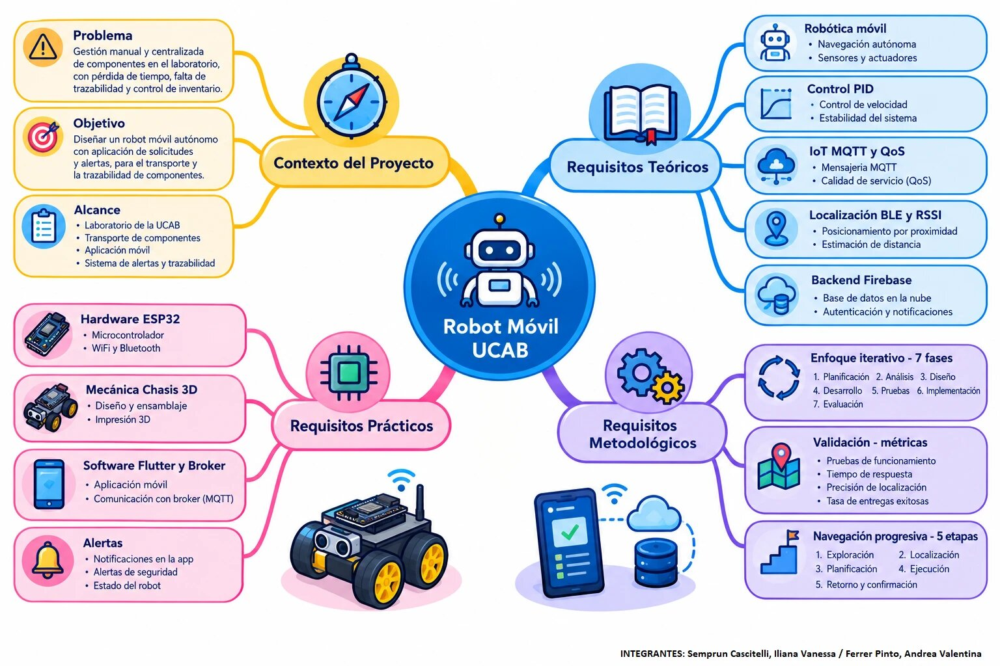

> Versión web de la tarea **T2 · Mapa Mental del Proyecto** del Seminario de Grado (actividad «Organiza tu investigación con mapas mentales»). La imagen original se puede descargar desde la cabecera de este visor.

# Mapa mental del proyecto · Robot Móvil UCAB

**Integrantes:** Semprun Cascitelli, Iliana Vanessa / Ferrer Pinto, Andrea Valentina

## Estructura del mapa

**Nodo central:** Robot Móvil UCAB. De él salen cuatro ramas principales.

### 1. Contexto del Proyecto

| Nodo | Contenido |
|---|---|
| **Problema** | Gestión manual y centralizada de componentes en el laboratorio, con pérdida de tiempo, falta de trazabilidad y control de inventario. |
| **Objetivo** | Diseñar un robot móvil autónomo con aplicación de solicitudes y alertas, para el transporte y la trazabilidad de componentes. |
| **Alcance** | Laboratorio de la UCAB · Transporte de componentes · Aplicación móvil · Sistema de alertas y trazabilidad. |

### 2. Requisitos Teóricos

| Nodo | Contenido |
|---|---|
| **Robótica móvil** | Navegación autónoma · Sensores y actuadores. |
| **Control PID** | Control de velocidad · Estabilidad del sistema. |
| **IoT MQTT y QoS** | Mensajería MQTT · Calidad de servicio (QoS). |
| **Localización BLE y RSSI** | Posicionamiento por proximidad · Estimación de distancia. |
| **Backend Firebase** | Base de datos en la nube · Autenticación y notificaciones. |

### 3. Requisitos Prácticos

| Nodo | Contenido |
|---|---|
| **Hardware ESP32** | Microcontrolador · WiFi y Bluetooth. |
| **Mecánica Chasis 3D** | Diseño y ensamblaje · Impresión 3D. |
| **Software Flutter y Broker** | Aplicación móvil · Comunicación con broker (MQTT). |
| **Alertas** | Notificaciones en la app · Alertas de seguridad · Estado del robot. |

### 4. Requisitos Metodológicos

| Nodo | Contenido |
|---|---|
| **Enfoque iterativo – 7 fases** | 1. Planificación · 2. Análisis · 3. Diseño · 4. Desarrollo · 5. Pruebas · 6. Implementación · 7. Evaluación. |
| **Validación – métricas** | Pruebas de funcionamiento · Tiempo de respuesta · Precisión de localización · Tasa de entregas exitosas. |
| **Navegación progresiva – 5 etapas** | 1. Exploración · 2. Localización · 3. Planificación · 4. Ejecución · 5. Retorno y confirmación. |
